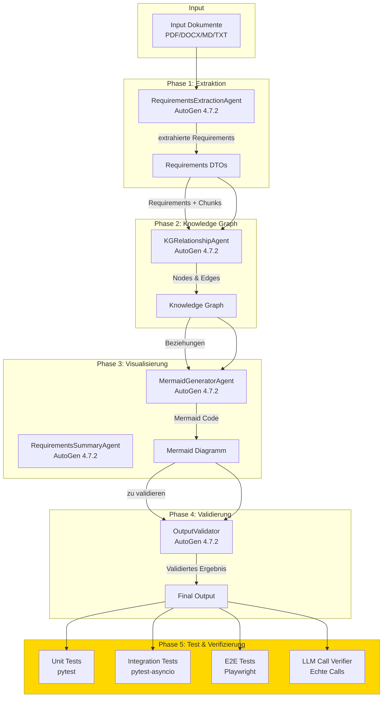

# Atomarer Task-Plan: Requirements Mermaid & KG System mit AutoGen 4.7.2

## Überblick

Ein detaillierter atomarer Task-Plan für die Erstellung eines Requirements Mermaid & KG Systems mit Test, Validierung und Verifizierung auf echte LLM-Calls unter Verwendung von AutoGen 4.7.2.

## Architektur-Übersicht



## Atomare Tasks

### Phase 1: Setup & Konfiguration

#### Task 1.1: AutoGen 4.7.2 Installation und Konfiguration
**Ziel:** AutoGen 4.7.2 installieren und konfigurieren

**Schritte:**
1. requirements.txt aktualisieren mit AutoGen 4.7.2
2. AutoGen 4.7.2 installieren
3. AutoGen-Konfiguration erstellen (config/autogen_config.json)
4. LLM-Client für AutoGen konfigurieren (OpenAI/OpenRouter)
5. Test-Script erstellen um AutoGen-Installation zu verifizieren

**Input:**
- requirements.txt
- .env.example

**Output:**
- Aktualisierte requirements.txt mit AutoGen 4.7.2
- config/autogen_config.json
- scripts/test_autogen_installation.py

**Validierung:**
- AutoGen 4.7.2 erfolgreich installiert
- AutoGen-Konfiguration geladen
- LLM-Client erfolgreich verbunden

**Test:**
```python
# scripts/test_autogen_installation.py
def test_autogen_version():
    import autogen
    assert autogen.__version__ == "4.7.2"
    
def test_autogen_config():
    from config.autogen_config import get_autogen_config
    config = get_autogen_config()
    assert config["model"] is not None
    assert config["api_key"] is not None
```

---

#### Task 1.2: Test-Daten und Mock-LLM-Calls vorbereiten
**Ziel:** Test-Daten und Mock-LLM-Calls für Unit-Tests vorbereiten

**Schritte:**
1. Test-Dokumente erstellen (data/test_documents/)
2. Mock-LLM-Calls definieren (tests/mocks/mock_llm_calls.py)
3. Test-Requirements definieren (tests/fixtures/test_requirements.json)
4. Test-Knowledge Graph definieren (tests/fixtures/test_kg.json)
5. Test-Mermaid-Diagramme definieren (tests/fixtures/test_mermaid.json)

**Input:**
- Keine

**Output:**
- data/test_documents/test_requirements.md
- data/test_documents/test_requirements.pdf
- tests/mocks/mock_llm_calls.py
- tests/fixtures/test_requirements.json
- tests/fixtures/test_kg.json
- tests/fixtures/test_mermaid.json

**Validierung:**
- Test-Dokumente sind gültig
- Mock-LLM-Calls sind definiert
- Test-Fixtures sind gültig

**Test:**
```python
# tests/test_fixtures.py
def test_test_documents_exist():
    import os
    assert os.path.exists("data/test_documents/test_requirements.md")
    assert os.path.exists("data/test_documents/test_requirements.pdf")
    
def test_mock_llm_calls_defined():
    from tests.mocks.mock_llm_calls import mock_llm_calls
    assert len(mock_llm_calls) > 0
```

---

### Phase 2: RequirementsExtractionAgent

#### Task 2.1: RequirementsExtractionAgent mit AutoGen 4.7.2 erstellen
**Ziel:** RequirementsExtractionAgent mit AutoGen 4.7.2 erstellen

**Schritte:**
1. AutoGen-Agent-Klasse erstellen (arch_team/agents/requirements_extraction_agent.py)
2. AutoGen-Konfiguration laden
3. LLM-Client initialisieren
4. Prompt-Template für Requirements-Extraktion erstellen
5. Function-Calling für Requirements-Extraktion definieren
6. Cross-Chunk Kontext implementieren
7. Deduplizierung implementieren
8. Validierung implementieren

**Input:**
- config/autogen_config.json
- arch_team/agents/chunk_miner_agent.py (Referenz)

**Output:**
- arch_team/agents/requirements_extraction_agent.py

**Validierung:**
- AutoGen-Agent erfolgreich erstellt
- LLM-Client erfolgreich initialisiert
- Prompt-Template erfolgreich erstellt
- Function-Calling erfolgreich definiert
- Cross-Chunk Kontext erfolgreich implementiert
- Deduplizierung erfolgreich implementiert
- Validierung erfolgreich implementiert

**Test:**
```python
# tests/arch_team/test_requirements_extraction_agent.py
import pytest
from arch_team.agents.requirements_extraction_agent import RequirementsExtractionAgent

@pytest.mark.asyncio
async def test_agent_initialization():
    agent = RequirementsExtractionAgent()
    assert agent is not None
    assert agent.llm_client is not None
    
@pytest.mark.asyncio
async def test_extract_requirements_from_text():
    agent = RequirementsExtractionAgent()
    text = "The system must authenticate users within 2 seconds."
    requirements = await agent.extract_requirements(text)
    assert len(requirements) > 0
    assert requirements[0]["text"] == text
    
@pytest.mark.asyncio
async def test_cross_chunk_context():
    agent = RequirementsExtractionAgent()
    chunks = ["Chunk 1", "Chunk 2", "Chunk 3"]
    requirements = await agent.extract_requirements_with_context(chunks)
    assert len(requirements) > 0
    
@pytest.mark.asyncio
async def test_deduplication():
    agent = RequirementsExtractionAgent()
    requirements = [
        {"text": "The system must authenticate users within 2 seconds."},
        {"text": "The system must authenticate users within 2 seconds."}
    ]
    deduplicated = await agent.deduplicate_requirements(requirements)
    assert len(deduplicated) == 1
```

---

#### Task 2.2: RequirementsExtractionAgent Unit-Tests erstellen
**Ziel:** Unit-Tests für RequirementsExtractionAgent erstellen

**Schritte:**
1. Unit-Tests für Agent-Initialisierung erstellen
2. Unit-Tests für Requirements-Extraktion erstellen
3. Unit-Tests für Cross-Chunk Kontext erstellen
4. Unit-Tests für Deduplizierung erstellen
5. Unit-Tests für Validierung erstellen
6. Mock-LLM-Calls für Tests verwenden
7. Test-Fixtures für Tests verwenden

**Input:**
- arch_team/agents/requirements_extraction_agent.py
- tests/mocks/mock_llm_calls.py
- tests/fixtures/test_requirements.json

**Output:**
- tests/arch_team/test_requirements_extraction_agent.py

**Validierung:**
- Alle Unit-Tests erfolgreich
- Code-Coverage > 80%

**Test:**
```bash
pytest tests/arch_team/test_requirements_extraction_agent.py -v --cov=arch_team/agents/requirements_extraction_agent
```

---

#### Task 2.3: RequirementsExtractionAgent Integration-Tests erstellen
**Ziel:** Integration-Tests für RequirementsExtractionAgent erstellen

**Schritte:**
1. Integration-Tests für Requirements-Extraktion aus PDF erstellen
2. Integration-Tests für Requirements-Extraktion aus DOCX erstellen
3. Integration-Tests für Requirements-Extraktion aus MD erstellen
4. Integration-Tests für Requirements-Extraktion aus TXT erstellen
5. Echte LLM-Calls für Tests verwenden
6. Test-Dokumente für Tests verwenden

**Input:**
- arch_team/agents/requirements_extraction_agent.py
- data/test_documents/test_requirements.pdf
- data/test_documents/test_requirements.docx
- data/test_documents/test_requirements.md
- data/test_documents/test_requirements.txt

**Output:**
- tests/arch_team/integration/test_requirements_extraction_agent.py

**Validierung:**
- Alle Integration-Tests erfolgreich
- Echte LLM-Calls erfolgreich

**Test:**
```bash
pytest tests/arch_team/integration/test_requirements_extraction_agent.py -v --cov=arch_team/agents/requirements_extraction_agent
```

---

### Phase 3: KGRelationshipAgent

#### Task 3.1: KGRelationshipAgent mit AutoGen 4.7.2 erstellen
**Ziel:** KGRelationshipAgent mit AutoGen 4.7.2 erstellen

**Schritte:**
1. AutoGen-Agent-Klasse erstellen (arch_team/agents/kg_relationship_agent.py)
2. AutoGen-Konfiguration laden
3. LLM-Client initialisieren
4. Prompt-Template für Beziehungserkennung erstellen
5. Function-Calling für Beziehungserkennung definieren
6. Beziehungstypen definieren (DEPENDS_ON, CONFLICTS_WITH, GROUPED_WITH, ACTOR_RELATION, DATA_FLOW, IMPLEMENTED_BY)
7. Node-Typen definieren (Requirement, Actor, Entity, Tag, Group)
8. Edge-Typen definieren
9. Knowledge Graph erstellen

**Input:**
- config/autogen_config.json
- arch_team/agents/requirements_extraction_agent.py

**Output:**
- arch_team/agents/kg_relationship_agent.py

**Validierung:**
- AutoGen-Agent erfolgreich erstellt
- LLM-Client erfolgreich initialisiert
- Prompt-Template erfolgreich erstellt
- Function-Calling erfolgreich definiert
- Beziehungstypen erfolgreich definiert
- Node-Typen erfolgreich definiert
- Edge-Typen erfolgreich definiert
- Knowledge Graph erfolgreich erstellt

**Test:**
```python
# tests/arch_team/test_kg_relationship_agent.py
import pytest
from arch_team.agents.kg_relationship_agent import KGRelationshipAgent

@pytest.mark.asyncio
async def test_agent_initialization():
    agent = KGRelationshipAgent()
    assert agent is not None
    assert agent.llm_client is not None
    
@pytest.mark.asyncio
async def test_extract_relationships():
    agent = KGRelationshipAgent()
    requirements = [
        {"id": "REQ-001", "text": "The system must authenticate users within 2 seconds."},
        {"id": "REQ-002", "text": "User passwords must be encrypted using AES-256."}
    ]
    relationships = await agent.extract_relationships(requirements)
    assert len(relationships) > 0
    
@pytest.mark.asyncio
async def test_build_knowledge_graph():
    agent = KGRelationshipAgent()
    requirements = [
        {"id": "REQ-001", "text": "The system must authenticate users within 2 seconds."},
        {"id": "REQ-002", "text": "User passwords must be encrypted using AES-256."}
    ]
    kg = await agent.build_knowledge_graph(requirements)
    assert "nodes" in kg
    assert "edges" in kg
    assert len(kg["nodes"]) > 0
    assert len(kg["edges"]) > 0
```

---

#### Task 3.2: KGRelationshipAgent Unit-Tests erstellen
**Ziel:** Unit-Tests für KGRelationshipAgent erstellen

**Schritte:**
1. Unit-Tests für Agent-Initialisierung erstellen
2. Unit-Tests für Beziehungserkennung erstellen
3. Unit-Tests für Knowledge Graph-Erstellung erstellen
4. Mock-LLM-Calls für Tests verwenden
5. Test-Fixtures für Tests verwenden

**Input:**
- arch_team/agents/kg_relationship_agent.py
- tests/mocks/mock_llm_calls.py
- tests/fixtures/test_kg.json

**Output:**
- tests/arch_team/test_kg_relationship_agent.py

**Validierung:**
- Alle Unit-Tests erfolgreich
- Code-Coverage > 80%

**Test:**
```bash
pytest tests/arch_team/test_kg_relationship_agent.py -v --cov=arch_team/agents/kg_relationship_agent
```

---

#### Task 3.3: KGRelationshipAgent Integration-Tests erstellen
**Ziel:** Integration-Tests für KGRelationshipAgent erstellen

**Schritte:**
1. Integration-Tests für Beziehungserkennung aus Requirements erstellen
2. Integration-Tests für Knowledge Graph-Erstellung aus Requirements erstellen
3. Echte LLM-Calls für Tests verwenden
4. Test-Requirements für Tests verwenden

**Input:**
- arch_team/agents/kg_relationship_agent.py
- tests/fixtures/test_requirements.json

**Output:**
- tests/arch_team/integration/test_kg_relationship_agent.py

**Validierung:**
- Alle Integration-Tests erfolgreich
- Echte LLM-Calls erfolgreich

**Test:**
```bash
pytest tests/arch_team/integration/test_kg_relationship_agent.py -v --cov=arch_team/agents/kg_relationship_agent
```

---

### Phase 4: MermaidGeneratorAgent

#### Task 4.1: MermaidGeneratorAgent mit AutoGen 4.7.2 erstellen
**Ziel:** MermaidGeneratorAgent mit AutoGen 4.7.2 erstellen

**Schritte:**
1. AutoGen-Agent-Klasse erstellen (arch_team/agents/mermaid_generator_agent.py)
2. AutoGen-Konfiguration laden
3. LLM-Client initialisieren
4. Prompt-Template für Mermaid-Generierung erstellen
5. Function-Calling für Mermaid-Generierung definieren
6. Diagramm-Typen definieren (Dependency, Conflict, Grouped, Actor)
7. Mermaid-Diagramm generieren
8. Syntax-Validierung implementieren

**Input:**
- config/autogen_config.json
- arch_team/agents/kg_relationship_agent.py

**Output:**
- arch_team/agents/mermaid_generator_agent.py

**Validierung:**
- AutoGen-Agent erfolgreich erstellt
- LLM-Client erfolgreich initialisiert
- Prompt-Template erfolgreich erstellt
- Function-Calling erfolgreich definiert
- Diagramm-Typen erfolgreich definiert
- Mermaid-Diagramm erfolgreich generiert
- Syntax-Validierung erfolgreich implementiert

**Test:**
```python
# tests/arch_team/test_mermaid_generator_agent.py
import pytest
from arch_team.agents.mermaid_generator_agent import MermaidGeneratorAgent

@pytest.mark.asyncio
async def test_agent_initialization():
    agent = MermaidGeneratorAgent()
    assert agent is not None
    assert agent.llm_client is not None
    
@pytest.mark.asyncio
async def test_generate_mermaid_diagram():
    agent = MermaidGeneratorAgent()
    kg = {
        "nodes": [
            {"id": "REQ-001", "type": "Requirement", "text": "Auth"},
            {"id": "REQ-002", "type": "Requirement", "text": "Encryption"}
        ],
        "edges": [
            {"source": "REQ-001", "target": "REQ-002", "type": "DEPENDS_ON"}
        ]
    }
    mermaid = await agent.generate_mermaid_diagram(kg, "dependency")
    assert "graph" in mermaid
    assert "REQ-001" in mermaid
    assert "REQ-002" in mermaid
    
@pytest.mark.asyncio
async def test_validate_mermaid_syntax():
    agent = MermaidGeneratorAgent()
    mermaid = "graph TD\n  REQ001[REQ-001: Auth] --> REQ002[REQ-002: Encryption]"
    is_valid = await agent.validate_mermaid_syntax(mermaid)
    assert is_valid == True
```

---

#### Task 4.2: MermaidGeneratorAgent Unit-Tests erstellen
**Ziel:** Unit-Tests für MermaidGeneratorAgent erstellen

**Schritte:**
1. Unit-Tests für Agent-Initialisierung erstellen
2. Unit-Tests für Mermaid-Generierung erstellen
3. Unit-Tests für Syntax-Validierung erstellen
4. Mock-LLM-Calls für Tests verwenden
5. Test-Fixtures für Tests verwenden

**Input:**
- arch_team/agents/mermaid_generator_agent.py
- tests/mocks/mock_llm_calls.py
- tests/fixtures/test_mermaid.json

**Output:**
- tests/arch_team/test_mermaid_generator_agent.py

**Validierung:**
- Alle Unit-Tests erfolgreich
- Code-Coverage > 80%

**Test:**
```bash
pytest tests/arch_team/test_mermaid_generator_agent.py -v --cov=arch_team/agents/mermaid_generator_agent
```

---

#### Task 4.3: MermaidGeneratorAgent Integration-Tests erstellen
**Ziel:** Integration-Tests für MermaidGeneratorAgent erstellen

**Schritte:**
1. Integration-Tests für Mermaid-Generierung aus Knowledge Graph erstellen
2. Integration-Tests für Syntax-Validierung erstellen
3. Echte LLM-Calls für Tests verwenden
4. Test-Knowledge Graph für Tests verwenden

**Input:**
- arch_team/agents/mermaid_generator_agent.py
- tests/fixtures/test_kg.json

**Output:**
- tests/arch_team/integration/test_mermaid_generator_agent.py

**Validierung:**
- Alle Integration-Tests erfolgreich
- Echte LLM-Calls erfolgreich

**Test:**
```bash
pytest tests/arch_team/integration/test_mermaid_generator_agent.py -v --cov=arch_team/agents/mermaid_generator_agent
```

---

### Phase 5: RequirementsSummaryAgent

#### Task 5.1: RequirementsSummaryAgent mit AutoGen 4.7.2 erstellen
**Ziel:** RequirementsSummaryAgent mit AutoGen 4.7.2 erstellen

**Schritte:**
1. AutoGen-Agent-Klasse erstellen (arch_team/agents/requirements_summary_agent.py)
2. AutoGen-Konfiguration laden
3. LLM-Client initialisieren
4. Prompt-Template für Zusammenfassung erstellen
5. Function-Calling für Zusammenfassung definieren
6. Statistiken berechnen (Gesamtanzahl, Verteilung nach Tags, Verteilung nach Prioritäten)
7. Zusammenfassung generieren
8. Empfehlungen generieren

**Input:**
- config/autogen_config.json
- arch_team/agents/requirements_extraction_agent.py
- arch_team/agents/kg_relationship_agent.py
- arch_team/agents/mermaid_generator_agent.py

**Output:**
- arch_team/agents/requirements_summary_agent.py

**Validierung:**
- AutoGen-Agent erfolgreich erstellt
- LLM-Client erfolgreich initialisiert
- Prompt-Template erfolgreich erstellt
- Function-Calling erfolgreich definiert
- Statistiken erfolgreich berechnet
- Zusammenfassung erfolgreich generiert
- Empfehlungen erfolgreich generiert

**Test:**
```python
# tests/arch_team/test_requirements_summary_agent.py
import pytest
from arch_team.agents.requirements_summary_agent import RequirementsSummaryAgent

@pytest.mark.asyncio
async def test_agent_initialization():
    agent = RequirementsSummaryAgent()
    assert agent is not None
    assert agent.llm_client is not None
    
@pytest.mark.asyncio
async def test_generate_summary():
    agent = RequirementsSummaryAgent()
    requirements = [
        {"id": "REQ-001", "text": "The system must authenticate users within 2 seconds.", "tag": "Security", "priority": "Must"},
        {"id": "REQ-002", "text": "User passwords must be encrypted using AES-256.", "tag": "Security", "priority": "Must"}
    ]
    summary = await agent.generate_summary(requirements)
    assert "total_requirements" in summary
    assert summary["total_requirements"] == 2
    assert "by_tag" in summary
    assert "by_priority" in summary
```

---

#### Task 5.2: RequirementsSummaryAgent Unit-Tests erstellen
**Ziel:** Unit-Tests für RequirementsSummaryAgent erstellen

**Schritte:**
1. Unit-Tests für Agent-Initialisierung erstellen
2. Unit-Tests für Zusammenfassung erstellen
3. Unit-Tests für Statistiken erstellen
4. Mock-LLM-Calls für Tests verwenden
5. Test-Fixtures für Tests verwenden

**Input:**
- arch_team/agents/requirements_summary_agent.py
- tests/mocks/mock_llm_calls.py
- tests/fixtures/test_requirements.json

**Output:**
- tests/arch_team/test_requirements_summary_agent.py

**Validierung:**
- Alle Unit-Tests erfolgreich
- Code-Coverage > 80%

**Test:**
```bash
pytest tests/arch_team/test_requirements_summary_agent.py -v --cov=arch_team/agents/requirements_summary_agent
```

---

#### Task 5.3: RequirementsSummaryAgent Integration-Tests erstellen
**Ziel:** Integration-Tests für RequirementsSummaryAgent erstellen

**Schritte:**
1. Integration-Tests für Zusammenfassung aus Requirements erstellen
2. Integration-Tests für Statistiken erstellen
3. Echte LLM-Calls für Tests verwenden
4. Test-Requirements für Tests verwenden

**Input:**
- arch_team/agents/requirements_summary_agent.py
- tests/fixtures/test_requirements.json

**Output:**
- tests/arch_team/integration/test_requirements_summary_agent.py

**Validierung:**
- Alle Integration-Tests erfolgreich
- Echte LLM-Calls erfolgreich

**Test:**
```bash
pytest tests/arch_team/integration/test_requirements_summary_agent.py -v --cov=arch_team/agents/requirements_summary_agent
```

---

### Phase 6: OutputValidator

#### Task 6.1: OutputValidator mit AutoGen 4.7.2 erstellen
**Ziel:** OutputValidator mit AutoGen 4.7.2 erstellen

**Schritte:**
1. AutoGen-Agent-Klasse erstellen (arch_team/agents/output_validator.py)
2. AutoGen-Konfiguration laden
3. LLM-Client initialisieren
4. Prompt-Template für Validierung erstellen
5. Function-Calling für Validierung definieren
6. Syntax-Check implementieren
7. Konsistenz-Check implementieren
8. Vollständigkeits-Check implementieren
9. Semantik-Check implementieren
10. Cross-Reference-Check implementieren

**Input:**
- config/autogen_config.json
- arch_team/agents/mermaid_generator_agent.py
- arch_team/agents/kg_relationship_agent.py
- arch_team/agents/requirements_extraction_agent.py

**Output:**
- arch_team/agents/output_validator.py

**Validierung:**
- AutoGen-Agent erfolgreich erstellt
- LLM-Client erfolgreich initialisiert
- Prompt-Template erfolgreich erstellt
- Function-Calling erfolgreich definiert
- Syntax-Check erfolgreich implementiert
- Konsistenz-Check erfolgreich implementiert
- Vollständigkeits-Check erfolgreich implementiert
- Semantik-Check erfolgreich implementiert
- Cross-Reference-Check erfolgreich implementiert

**Test:**
```python
# tests/arch_team/test_output_validator.py
import pytest
from arch_team.agents.output_validator import OutputValidator

@pytest.mark.asyncio
async def test_agent_initialization():
    validator = OutputValidator()
    assert validator is not None
    assert validator.llm_client is not None
    
@pytest.mark.asyncio
async def test_validate_syntax():
    validator = OutputValidator()
    mermaid = "graph TD\n  REQ001[REQ-001: Auth] --> REQ002[REQ-002: Encryption]"
    result = await validator.validate_syntax(mermaid)
    assert result["valid"] == True
    
@pytest.mark.asyncio
async def test_validate_consistency():
    validator = OutputValidator()
    kg = {
        "nodes": [
            {"id": "REQ-001", "type": "Requirement", "text": "Auth"},
            {"id": "REQ-002", "type": "Requirement", "text": "Encryption"}
        ],
        "edges": [
            {"source": "REQ-001", "target": "REQ-002", "type": "DEPENDS_ON"}
        ]
    }
    mermaid = "graph TD\n  REQ001[REQ-001: Auth] --> REQ002[REQ-002: Encryption]"
    result = await validator.validate_consistency(kg, mermaid)
    assert result["valid"] == True
    
@pytest.mark.asyncio
async def test_validate_completeness():
    validator = OutputValidator()
    kg = {
        "nodes": [
            {"id": "REQ-001", "type": "Requirement", "text": "Auth"},
            {"id": "REQ-002", "type": "Requirement", "text": "Encryption"}
        ],
        "edges": [
            {"source": "REQ-001", "target": "REQ-002", "type": "DEPENDS_ON"}
        ]
    }
    mermaid = "graph TD\n  REQ001[REQ-001: Auth] --> REQ002[REQ-002: Encryption]"
    result = await validator.validate_completeness(kg, mermaid)
    assert result["valid"] == True
    
@pytest.mark.asyncio
async def test_validate_semantic():
    validator = OutputValidator()
    kg = {
        "nodes": [
            {"id": "REQ-001", "type": "Requirement", "text": "Auth"},
            {"id": "REQ-002", "type": "Requirement", "text": "Encryption"}
        ],
        "edges": [
            {"source": "REQ-001", "target": "REQ-002", "type": "DEPENDS_ON"}
        ]
    }
    result = await validator.validate_semantic(kg)
    assert result["valid"] == True
    
@pytest.mark.asyncio
async def test_validate_cross_reference():
    validator = OutputValidator()
    requirements = [
        {"id": "REQ-001", "text": "The system must authenticate users within 2 seconds.", "evidence_refs": ["chunk-1"]}
    ]
    result = await validator.validate_cross_reference(requirements)
    assert result["valid"] == True
```

---

#### Task 6.2: OutputValidator Unit-Tests erstellen
**Ziel:** Unit-Tests für OutputValidator erstellen

**Schritte:**
1. Unit-Tests für Agent-Initialisierung erstellen
2. Unit-Tests für Syntax-Check erstellen
3. Unit-Tests für Konsistenz-Check erstellen
4. Unit-Tests für Vollständigkeits-Check erstellen
5. Unit-Tests für Semantik-Check erstellen
6. Unit-Tests für Cross-Reference-Check erstellen
7. Mock-LLM-Calls für Tests verwenden
8. Test-Fixtures für Tests verwenden

**Input:**
- arch_team/agents/output_validator.py
- tests/mocks/mock_llm_calls.py
- tests/fixtures/test_mermaid.json
- tests/fixtures/test_kg.json
- tests/fixtures/test_requirements.json

**Output:**
- tests/arch_team/test_output_validator.py

**Validierung:**
- Alle Unit-Tests erfolgreich
- Code-Coverage > 80%

**Test:**
```bash
pytest tests/arch_team/test_output_validator.py -v --cov=arch_team/agents/output_validator
```

---

#### Task 6.3: OutputValidator Integration-Tests erstellen
**Ziel:** Integration-Tests für OutputValidator erstellen

**Schritte:**
1. Integration-Tests für Validierung erstellen
2. Echte LLM-Calls für Tests verwenden
3. Test-Mermaid-Diagramme für Tests verwenden
4. Test-Knowledge Graph für Tests verwenden
5. Test-Requirements für Tests verwenden

**Input:**
- arch_team/agents/output_validator.py
- tests/fixtures/test_mermaid.json
- tests/fixtures/test_kg.json
- tests/fixtures/test_requirements.json

**Output:**
- tests/arch_team/integration/test_output_validator.py

**Validierung:**
- Alle Integration-Tests erfolgreich
- Echte LLM-Calls erfolgreich

**Test:**
```bash
pytest tests/arch_team/integration/test_output_validator.py -v --cov=arch_team/agents/output_validator
```

---

### Phase 7: SwarmOrchestrator

#### Task 7.1: SwarmOrchestrator mit AutoGen 4.7.2 erstellen
**Ziel:** SwarmOrchestrator mit AutoGen 4.7.2 erstellen

**Schritte:**
1. AutoGen-Orchestrator-Klasse erstellen (arch_team/agents/swarm_orchestrator.py)
2. AutoGen-Konfiguration laden
3. LLM-Client initialisieren
4. Topic-Broker erstellen (Pub/Sub Pattern)
5. Shared State erstellen (Redis/Database)
6. Paralleles Starten aller Agents implementieren
7. Topic-basierte Kommunikation implementieren
8. Event-basierte Subscription implementieren
9. Fehlerbehandlung implementieren
10. Aggregation der Ergebnisse implementieren
11. Status-Tracking implementieren

**Input:**
- config/autogen_config.json
- arch_team/agents/requirements_extraction_agent.py
- arch_team/agents/kg_relationship_agent.py
- arch_team/agents/mermaid_generator_agent.py
- arch_team/agents/requirements_summary_agent.py
- arch_team/agents/output_validator.py

**Output:**
- arch_team/agents/swarm_orchestrator.py
- arch_team/core/topic_broker.py
- arch_team/core/shared_state.py

**Validierung:**
- AutoGen-Orchestrator erfolgreich erstellt
- LLM-Client erfolgreich initialisiert
- Topic-Broker erfolgreich erstellt
- Shared State erfolgreich erstellt
- Paralleles Starten aller Agents erfolgreich implementiert
- Topic-basierte Kommunikation erfolgreich implementiert
- Event-basierte Subscription erfolgreich implementiert
- Fehlerbehandlung erfolgreich implementiert
- Aggregation der Ergebnisse erfolgreich implementiert
- Status-Tracking erfolgreich implementiert

**Test:**
```python
# tests/arch_team/test_swarm_orchestrator.py
import pytest
from arch_team.agents.swarm_orchestrator import SwarmOrchestrator

@pytest.mark.asyncio
async def test_orchestrator_initialization():
    orchestrator = SwarmOrchestrator()
    assert orchestrator is not None
    assert orchestrator.topic_broker is not None
    assert orchestrator.shared_state is not None
    
@pytest.mark.asyncio
async def test_start_all_agents():
    orchestrator = SwarmOrchestrator()
    await orchestrator.start_all_agents()
    assert orchestrator.status == "running"
    
@pytest.mark.asyncio
async def test_topic_based_communication():
    orchestrator = SwarmOrchestrator()
    await orchestrator.publish_to_topic("requirements.topic", {"requirements": []})
    result = await orchestrator.subscribe_to_topic("requirements.topic")
    assert result is not None
    
@pytest.mark.asyncio
async def test_aggregate_results():
    orchestrator = SwarmOrchestrator()
    results = {
        "requirements": [],
        "knowledge_graph": {"nodes": [], "edges": []},
        "mermaid_diagram": "",
        "summary": {},
        "validation": {}
    }
    aggregated = await orchestrator.aggregate_results(results)
    assert aggregated is not None
```

---

#### Task 7.2: SwarmOrchestrator Unit-Tests erstellen
**Ziel:** Unit-Tests für SwarmOrchestrator erstellen

**Schritte:**
1. Unit-Tests für Orchestrator-Initialisierung erstellen
2. Unit-Tests für paralleles Starten aller Agents erstellen
3. Unit-Tests für Topic-basierte Kommunikation erstellen
4. Unit-Tests für Event-basierte Subscription erstellen
5. Unit-Tests für Fehlerbehandlung erstellen
6. Unit-Tests für Aggregation der Ergebnisse erstellen
7. Unit-Tests für Status-Tracking erstellen
8. Mock-LLM-Calls für Tests verwenden
9. Test-Fixtures für Tests verwenden

**Input:**
- arch_team/agents/swarm_orchestrator.py
- arch_team/core/topic_broker.py
- arch_team/core/shared_state.py
- tests/mocks/mock_llm_calls.py
- tests/fixtures/test_requirements.json
- tests/fixtures/test_kg.json
- tests/fixtures/test_mermaid.json

**Output:**
- tests/arch_team/test_swarm_orchestrator.py
- tests/arch_team/test_topic_broker.py
- tests/arch_team/test_shared_state.py

**Validierung:**
- Alle Unit-Tests erfolgreich
- Code-Coverage > 80%

**Test:**
```bash
pytest tests/arch_team/test_swarm_orchestrator.py -v --cov=arch_team/agents/swarm_orchestrator
pytest tests/arch_team/test_topic_broker.py -v --cov=arch_team/core/topic_broker
pytest tests/arch_team/test_shared_state.py -v --cov=arch_team/core/shared_state
```

---

#### Task 7.3: SwarmOrchestrator Integration-Tests erstellen
**Ziel:** Integration-Tests für SwarmOrchestrator erstellen

**Schritte:**
1. Integration-Tests für kompletten Workflow erstellen
2. Echte LLM-Calls für Tests verwenden
3. Test-Dokumente für Tests verwenden

**Input:**
- arch_team/agents/swarm_orchestrator.py
- data/test_documents/test_requirements.md

**Output:**
- tests/arch_team/integration/test_swarm_orchestrator.py

**Validierung:**
- Alle Integration-Tests erfolgreich
- Echte LLM-Calls erfolgreich

**Test:**
```bash
pytest tests/arch_team/integration/test_swarm_orchestrator.py -v --cov=arch_team/agents/swarm_orchestrator
```

---

### Phase 8: LLM Call Verifier

#### Task 8.1: LLM Call Verifier erstellen
**Ziel:** LLM Call Verifier erstellen um echte LLM-Calls zu verifizieren

**Schritte:**
1. LLM Call Verifier-Klasse erstellen (arch_team/core/llm_call_verifier.py)
2. LLM-Client initialisieren
3. LLM-Calls loggen
4. LLM-Calls validieren
5. LLM-Calls verifizieren
6. LLM-Call-Statistiken erstellen

**Input:**
- config/autogen_config.json

**Output:**
- arch_team/core/llm_call_verifier.py

**Validierung:**
- LLM Call Verifier erfolgreich erstellt
- LLM-Client erfolgreich initialisiert
- LLM-Calls erfolgreich geloggt
- LLM-Calls erfolgreich validiert
- LLM-Calls erfolgreich verifiziert
- LLM-Call-Statistiken erfolgreich erstellt

**Test:**
```python
# tests/arch_team/test_llm_call_verifier.py
import pytest
from arch_team.core.llm_call_verifier import LLMCallVerifier

@pytest.mark.asyncio
async def test_verifier_initialization():
    verifier = LLMCallVerifier()
    assert verifier is not None
    assert verifier.llm_client is not None
    
@pytest.mark.asyncio
async def test_log_llm_call():
    verifier = LLMCallVerifier()
    await verifier.log_llm_call("test_prompt", "test_response", 100)
    assert len(verifier.calls) == 1
    
@pytest.mark.asyncio
async def test_validate_llm_call():
    verifier = LLMCallVerifier()
    is_valid = await verifier.validate_llm_call("test_prompt", "test_response")
    assert is_valid == True
    
@pytest.mark.asyncio
async def test_verify_llm_call():
    verifier = LLMCallVerifier()
    is_verified = await verifier.verify_llm_call("test_prompt", "test_response")
    assert is_verified == True
    
@pytest.mark.asyncio
async def test_get_llm_call_statistics():
    verifier = LLMCallVerifier()
    await verifier.log_llm_call("test_prompt", "test_response", 100)
    stats = await verifier.get_llm_call_statistics()
    assert "total_calls" in stats
    assert stats["total_calls"] == 1
```

---

#### Task 8.2: LLM Call Verifier Unit-Tests erstellen
**Ziel:** Unit-Tests für LLM Call Verifier erstellen

**Schritte:**
1. Unit-Tests für Verifier-Initialisierung erstellen
2. Unit-Tests für LLM-Call-Logging erstellen
3. Unit-Tests für LLM-Call-Validierung erstellen
4. Unit-Tests für LLM-Call-Verifizierung erstellen
5. Unit-Tests für LLM-Call-Statistiken erstellen
6. Mock-LLM-Calls für Tests verwenden

**Input:**
- arch_team/core/llm_call_verifier.py
- tests/mocks/mock_llm_calls.py

**Output:**
- tests/arch_team/test_llm_call_verifier.py

**Validierung:**
- Alle Unit-Tests erfolgreich
- Code-Coverage > 80%

**Test:**
```bash
pytest tests/arch_team/test_llm_call_verifier.py -v --cov=arch_team/core/llm_call_verifier
```

---

#### Task 8.3: LLM Call Verifier Integration-Tests erstellen
**Ziel:** Integration-Tests für LLM Call Verifier erstellen

**Schritte:**
1. Integration-Tests für LLM-Call-Verifizierung erstellen
2. Echte LLM-Calls für Tests verwenden

**Input:**
- arch_team/core/llm_call_verifier.py

**Output:**
- tests/arch_team/integration/test_llm_call_verifier.py

**Validierung:**
- Alle Integration-Tests erfolgreich
- Echte LLM-Calls erfolgreich

**Test:**
```bash
pytest tests/arch_team/integration/test_llm_call_verifier.py -v --cov=arch_team/core/llm_call_verifier
```

---

### Phase 9: API-Endpunkte

#### Task 9.1: API-Endpunkte erstellen
**Ziel:** API-Endpunkte für neuen Workflow erstellen

**Schritte:**
1. FastAPI-Router erstellen (backend/routers/workflow_router.py)
2. POST /api/workflow/start erstellen
3. GET /api/workflow/status/{workflow_id} erstellen
4. GET /api/workflow/result/{workflow_id} erstellen
5. Request/Response-Modelle definieren
6. Fehlerbehandlung implementieren
7. Authentifizierung implementieren (optional)

**Input:**
- arch_team/agents/swarm_orchestrator.py

**Output:**
- backend/routers/workflow_router.py
- backend/models/workflow_models.py

**Validierung:**
- FastAPI-Router erfolgreich erstellt
- POST /api/workflow/start erfolgreich erstellt
- GET /api/workflow/status/{workflow_id} erfolgreich erstellt
- GET /api/workflow/result/{workflow_id} erfolgreich erstellt
- Request/Response-Modelle erfolgreich definiert
- Fehlerbehandlung erfolgreich implementiert
- Authentifizierung erfolgreich implementiert (optional)

**Test:**
```python
# tests/backend/test_workflow_router.py
import pytest
from fastapi.testclient import TestClient
from backend.routers.workflow_router import router

client = TestClient(router)

def test_start_workflow():
    response = client.post("/api/workflow/start", json={
        "files": ["test_requirements.md"],
        "options": {
            "chunk_size": 800,
            "chunk_overlap": 200,
            "neighbor_refs": True,
            "diagram_type": "dependency"
        }
    })
    assert response.status_code == 200
    assert "workflow_id" in response.json()
    
def test_get_workflow_status():
    response = client.get("/api/workflow/status/wf-abc123")
    assert response.status_code == 200
    assert "status" in response.json()
    
def test_get_workflow_result():
    response = client.get("/api/workflow/result/wf-abc123")
    assert response.status_code == 200
    assert "requirements" in response.json()
```

---

#### Task 9.2: API-Endpunkte Unit-Tests erstellen
**Ziel:** Unit-Tests für API-Endpunkte erstellen

**Schritte:**
1. Unit-Tests für POST /api/workflow/start erstellen
2. Unit-Tests für GET /api/workflow/status/{workflow_id} erstellen
3. Unit-Tests für GET /api/workflow/result/{workflow_id} erstellen
4. Mock-LLM-Calls für Tests verwenden

**Input:**
- backend/routers/workflow_router.py
- tests/mocks/mock_llm_calls.py

**Output:**
- tests/backend/test_workflow_router.py

**Validierung:**
- Alle Unit-Tests erfolgreich
- Code-Coverage > 80%

**Test:**
```bash
pytest tests/backend/test_workflow_router.py -v --cov=backend/routers/workflow_router
```

---

#### Task 9.3: API-Endpunkte Integration-Tests erstellen
**Ziel:** Integration-Tests für API-Endpunkte erstellen

**Schritte:**
1. Integration-Tests für kompletten Workflow erstellen
2. Echte LLM-Calls für Tests verwenden
3. Test-Dokumente für Tests verwenden

**Input:**
- backend/routers/workflow_router.py
- data/test_documents/test_requirements.md

**Output:**
- tests/backend/integration/test_workflow_router.py

**Validierung:**
- Alle Integration-Tests erfolgreich
- Echte LLM-Calls erfolgreich

**Test:**
```bash
pytest tests/backend/integration/test_workflow_router.py -v --cov=backend/routers/workflow_router
```

---

### Phase 10: Frontend-Komponente

#### Task 10.1: Frontend-Komponente erstellen
**Ziel:** Frontend-Komponente für Visualisierung erstellen

**Schritte:**
1. React-Komponente erstellen (src/components/RequirementsMermaid.jsx)
2. Mermaid-Diagramm rendern
3. Knowledge Graph visualisieren
4. Requirements anzeigen
5. Zusammenfassung anzeigen
6. Validierungsergebnisse anzeigen
7. Interaktive Features implementieren

**Input:**
- backend/routers/workflow_router.py

**Output:**
- src/components/RequirementsMermaid.jsx
- src/components/KnowledgeGraph.jsx
- src/components/RequirementsList.jsx
- src/components/RequirementsSummary.jsx
- src/components/ValidationResults.jsx

**Validierung:**
- React-Komponente erfolgreich erstellt
- Mermaid-Diagramm erfolgreich gerendert
- Knowledge Graph erfolgreich visualisiert
- Requirements erfolgreich angezeigt
- Zusammenfassung erfolgreich angezeigt
- Validierungsergebnisse erfolgreich angezeigt
- Interaktive Features erfolgreich implementiert

**Test:**
```javascript
// tests/src/components/RequirementsMermaid.test.jsx
import { render, screen } from '@testing-library/react';
import RequirementsMermaid from '../../src/components/RequirementsMermaid';

test('renders mermaid diagram', () => {
  const mermaid = 'graph TD\n  REQ001[REQ-001: Auth] --> REQ002[REQ-002: Encryption]';
  render(<RequirementsMermaid mermaid={mermaid} />);
  expect(screen.getByText('REQ-001: Auth')).toBeInTheDocument();
});
```

---

#### Task 10.2: Frontend-Komponente Unit-Tests erstellen
**Ziel:** Unit-Tests für Frontend-Komponente erstellen

**Schritte:**
1. Unit-Tests für RequirementsMermaid erstellen
2. Unit-Tests für KnowledgeGraph erstellen
3. Unit-Tests für RequirementsList erstellen
4. Unit-Tests für RequirementsSummary erstellen
5. Unit-Tests für ValidationResults erstellen

**Input:**
- src/components/RequirementsMermaid.jsx
- src/components/KnowledgeGraph.jsx
- src/components/RequirementsList.jsx
- src/components/RequirementsSummary.jsx
- src/components/ValidationResults.jsx

**Output:**
- tests/src/components/RequirementsMermaid.test.jsx
- tests/src/components/KnowledgeGraph.test.jsx
- tests/src/components/RequirementsList.test.jsx
- tests/src/components/RequirementsSummary.test.jsx
- tests/src/components/ValidationResults.test.jsx

**Validierung:**
- Alle Unit-Tests erfolgreich
- Code-Coverage > 80%

**Test:**
```bash
npm test -- --coverage
```

---

#### Task 10.3: Frontend-Komponente E2E-Tests erstellen
**Ziel:** E2E-Tests für Frontend-Komponente erstellen

**Schritte:**
1. E2E-Tests für kompletten Workflow erstellen
2. Playwright für E2E-Tests verwenden

**Input:**
- src/components/RequirementsMermaid.jsx
- src/components/KnowledgeGraph.jsx
- src/components/RequirementsList.jsx
- src/components/RequirementsSummary.jsx
- src/components/ValidationResults.jsx

**Output:**
- tests/e2e/workflow.spec.ts

**Validierung:**
- Alle E2E-Tests erfolgreich

**Test:**
```bash
npx playwright test
```

---

### Phase 11: Dokumentation

#### Task 11.1: README aktualisieren
**Ziel:** README aktualisieren

**Schritte:**
1. README.md aktualisieren
2. Installation-Anleitung hinzufügen
3. Konfiguration-Anleitung hinzufügen
4. API-Dokumentation hinzufügen
5. Beispiele hinzufügen

**Input:**
- Alle erstellten Komponenten

**Output:**
- README.md

**Validierung:**
- README.md erfolgreich aktualisiert
- Installation-Anleitung erfolgreich hinzugefügt
- Konfiguration-Anleitung erfolgreich hinzugefügt
- API-Dokumentation erfolgreich hinzugefügt
- Beispiele erfolgreich hinzugefügt

---

#### Task 11.2: API-Dokumentation erstellen
**Ziel:** API-Dokumentation erstellen

**Schritte:**
1. API-Dokumentation erstellen (docs/api.md)
2. Endpunkte dokumentieren
3. Request/Response-Modelle dokumentieren
4. Beispiele hinzufügen

**Input:**
- backend/routers/workflow_router.py
- backend/models/workflow_models.py

**Output:**
- docs/api.md

**Validierung:**
- API-Dokumentation erfolgreich erstellt
- Endpunkte erfolgreich dokumentiert
- Request/Response-Modelle erfolgreich dokumentiert
- Beispiele erfolgreich hinzugefügt

---

#### Task 11.3: Entwickler-Dokumentation erstellen
**Ziel:** Entwickler-Dokumentation erstellen

**Schritte:**
1. Entwickler-Dokumentation erstellen (docs/developer.md)
2. Architektur dokumentieren
3. Komponenten dokumentieren
4. Tests dokumentieren
5. Beispiele hinzufügen

**Input:**
- Alle erstellten Komponenten

**Output:**
- docs/developer.md

**Validierung:**
- Entwickler-Dokumentation erfolgreich erstellt
- Architektur erfolgreich dokumentiert
- Komponenten erfolgreich dokumentiert
- Tests erfolgreich dokumentiert
- Beispiele erfolgreich hinzugefügt

---

## Zusammenfassung

### Atomare Tasks

| Phase | Task | Status |
|-------|------|--------|
| 1.1 | AutoGen 4.7.2 Installation und Konfiguration | Pending |
| 1.2 | Test-Daten und Mock-LLM-Calls vorbereiten | Pending |
| 2.1 | RequirementsExtractionAgent mit AutoGen 4.7.2 erstellen | Pending |
| 2.2 | RequirementsExtractionAgent Unit-Tests erstellen | Pending |
| 2.3 | RequirementsExtractionAgent Integration-Tests erstellen | Pending |
| 3.1 | KGRelationshipAgent mit AutoGen 4.7.2 erstellen | Pending |
| 3.2 | KGRelationshipAgent Unit-Tests erstellen | Pending |
| 3.3 | KGRelationshipAgent Integration-Tests erstellen | Pending |
| 4.1 | MermaidGeneratorAgent mit AutoGen 4.7.2 erstellen | Pending |
| 4.2 | MermaidGeneratorAgent Unit-Tests erstellen | Pending |
| 4.3 | MermaidGeneratorAgent Integration-Tests erstellen | Pending |
| 5.1 | RequirementsSummaryAgent mit AutoGen 4.7.2 erstellen | Pending |
| 5.2 | RequirementsSummaryAgent Unit-Tests erstellen | Pending |
| 5.3 | RequirementsSummaryAgent Integration-Tests erstellen | Pending |
| 6.1 | OutputValidator mit AutoGen 4.7.2 erstellen | Pending |
| 6.2 | OutputValidator Unit-Tests erstellen | Pending |
| 6.3 | OutputValidator Integration-Tests erstellen | Pending |
| 7.1 | SwarmOrchestrator mit AutoGen 4.7.2 erstellen | Pending |
| 7.2 | SwarmOrchestrator Unit-Tests erstellen | Pending |
| 7.3 | SwarmOrchestrator Integration-Tests erstellen | Pending |
| 8.1 | LLM Call Verifier erstellen | Pending |
| 8.2 | LLM Call Verifier Unit-Tests erstellen | Pending |
| 8.3 | LLM Call Verifier Integration-Tests erstellen | Pending |
| 9.1 | API-Endpunkte erstellen | Pending |
| 9.2 | API-Endpunkte Unit-Tests erstellen | Pending |
| 9.3 | API-Endpunkte Integration-Tests erstellen | Pending |
| 10.1 | Frontend-Komponente erstellen | Pending |
| 10.2 | Frontend-Komponente Unit-Tests erstellen | Pending |
| 10.3 | Frontend-Komponente E2E-Tests erstellen | Pending |
| 11.1 | README aktualisieren | Pending |
| 11.2 | API-Dokumentation erstellen | Pending |
| 11.3 | Entwickler-Dokumentation erstellen | Pending |

### Test-Strategie

#### Unit-Tests
- Mock-LLM-Calls verwenden
- Test-Fixtures verwenden
- Code-Coverage > 80%

#### Integration-Tests
- Echte LLM-Calls verwenden
- Test-Dokumente verwenden
- Alle Komponenten testen

#### E2E-Tests
- Kompletten Workflow testen
- Playwright für Frontend-Tests verwenden

### Validierung

#### LLM Call Verifier
- LLM-Calls loggen
- LLM-Calls validieren
- LLM-Calls verifizieren
- LLM-Call-Statistiken erstellen

### AutoGen 4.7.2

#### Installation
```bash
pip install autogen-agentchat==4.7.2
pip install autogen-core==4.7.2
pip install autogen-ext==4.7.2
```

#### Konfiguration
```json
{
  "model": "gpt-4o",
  "api_key": "your-api-key",
  "temperature": 0.7,
  "max_tokens": 2000
}
```

### Nächste Schritte

1. AutoGen 4.7.2 installieren und konfigurieren
2. Test-Daten und Mock-LLM-Calls vorbereiten
3. RequirementsExtractionAgent erstellen und testen
4. KGRelationshipAgent erstellen und testen
5. MermaidGeneratorAgent erstellen und testen
6. RequirementsSummaryAgent erstellen und testen
7. OutputValidator erstellen und testen
8. SwarmOrchestrator erstellen und testen
9. LLM Call Verifier erstellen und testen
10. API-Endpunkte erstellen und testen
11. Frontend-Komponente erstellen und testen
12. Dokumentation aktualisieren
